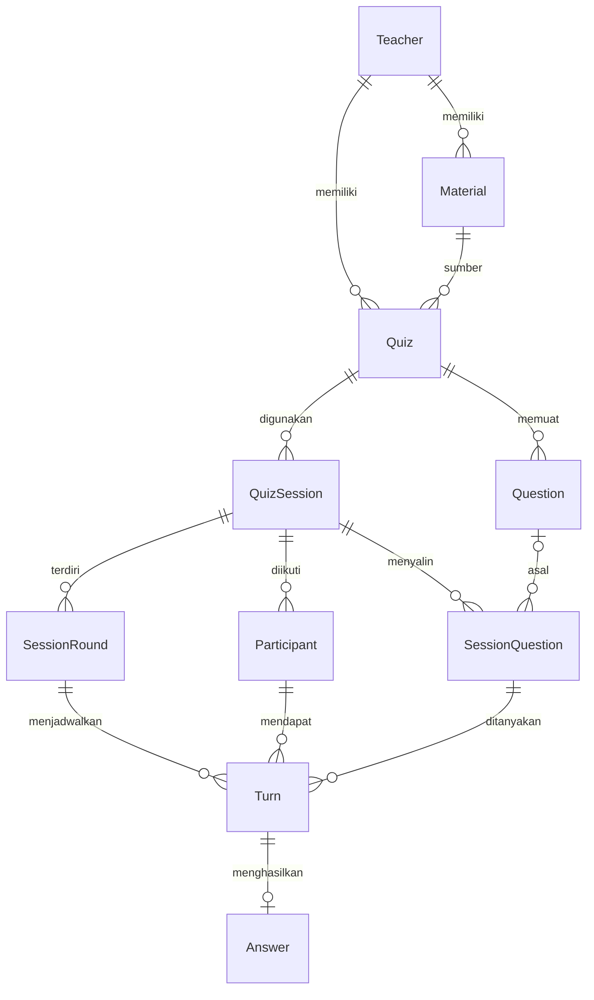
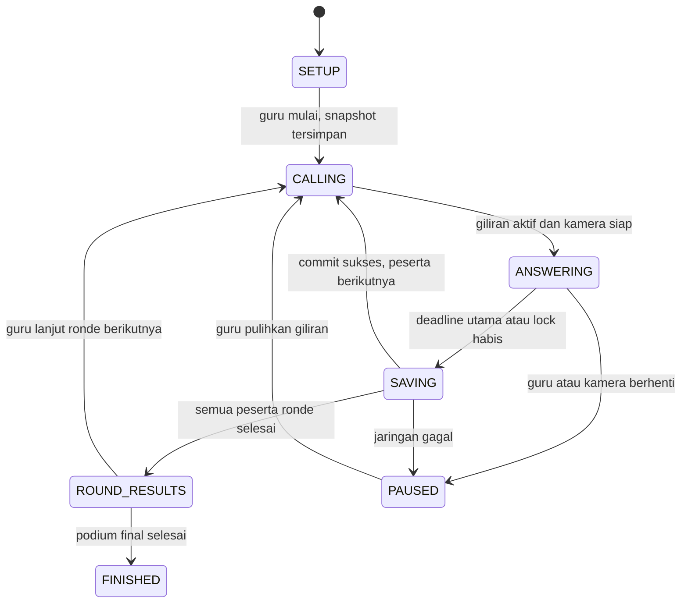

# Arsitektur data dan state aljamicerdas.id

## Ruang lingkup dan keputusan awal

Satu santri mendapat satu giliran per ronde. Setiap giliran menunjuk satu soal, sehingga guru dapat memakai soal sama atau berbeda untuk santri dalam ronde tersebut. Semua santri mengikuti final. Ronde terakhir selalu final; bila jumlah ronde satu, ronde tersebut adalah final. Ronde biasa memakai A/B/C dan kesulitan EASY atau MEDIUM; final memakai A/B/C/D dan kesulitan HARD. Benar bernilai 1, salah atau kosong bernilai 0, termasuk pada final.

Nama santri disimpan sebagai peserta sesi, bukan akun login. Dua santri boleh memiliki nama sama karena identitasnya memakai UUID. `registrationOrder` tetap sejak pendaftaran; `queuePosition` boleh berubah saat SETUP. Urutan mulai dari 0, nomor ronde mulai dari 1.

## Relasi entitas



| Entitas         | Isi utama dan alasan                                                                         |
| --------------- | -------------------------------------------------------------------------------------------- |
| Teacher         | Identitas guru dari penyedia autentikasi melalui `authSubject`.                              |
| Material        | Jenis PDF/PPTX/MARKDOWN, nama file opsional, dan teks hasil ekstraksi.                       |
| Quiz            | Judul, sumber materi, status DRAFT/REVIEW/READY/ARCHIVED, revisi dan waktu persetujuan guru. |
| Question        | Soal yang dapat ditinjau guru, opsi, kunci, pembahasan dan tingkat kesulitan.                |
| QuizSession     | Pelaksanaan kuis, revisi kuis yang dipakai, jumlah ronde dan status sesi.                    |
| Participant     | Nama santri dan urutan dalam satu sesi.                                                      |
| SessionQuestion | Salinan isi soal saat sesi dimulai; tidak berubah selama/pasca sesi.                         |
| SessionRound    | Nomor ronde, mode REGULAR/FINAL dan status.                                                  |
| Turn            | Penghubung ronde, peserta, dan soal; menyimpan token percobaan aktif.                        |
| Answer          | Satu jawaban final per giliran, poin, penyebab berakhir, dan waktu penyimpanan.              |

`Question.content` dan `SessionQuestion.content` disimpan sebagai JSONB bertipe `QuestionContent`. Field mode membedakan bentuk opsi 3 dan 4 secara eksplisit. Ini mempertahankan satu paket teks, pilihan, kunci, dan pembahasan ketika disalin. Relasi lainnya memakai tabel serta foreign key. Tidak ada kolom total skor yang harus terus disinkronkan.

## Constraint database dan validasi layanan

SQL sudah mendefinisikan:

- Primary key pada setiap entitas, termasuk `Answer.turnId` untuk tepat satu hasil per giliran.
- Foreign key gabungan pada Turn agar ronde, peserta, dan salinan soal selalu berasal dari sesi yang sama.
- Foreign key gabungan materi/kuis/guru untuk menjaga kepemilikan.
- Unique `(roundId, participantId)` untuk satu giliran per santri per ronde.
- Unique `(sessionId, number)` serta indeks parsial untuk maksimal satu ronde final, satu ronde berjalan dan satu giliran aktif per sesi.
- Unique urutan peserta per sesi, ditunda hingga COMMIT agar pertukaran posisi dapat dilakukan dalam satu transaksi.
- CHECK poin 0/1, jawaban kosong bernilai 0, angka ronde positif, dan status dasar.

TypeScript bukan validator input runtime. API Express memakai Zod untuk memvalidasi JSON dari AI dan browser sebelum penyimpanan. Repository menerapkan transaksi di atas constraint SQL. Aturan layanan:

1. Teks soal dan opsi tidak kosong; opsi tepat A/B/C untuk REGULAR atau A/B/C/D untuk FINAL, tanpa kunci tambahan. Kunci benar harus ada dalam opsi. Kesulitan sesuai mode. Respons AI masuk REVIEW, tidak boleh langsung READY.
2. Guru hanya dapat membaca/mengubah miliknya. Kunci API AI berada di server. Perubahan soal mengembalikan kuis ke REVIEW, menghapus `reviewedAt`, menaikkan `revision`, dan mengubah `updatedAt`.
3. Saat mulai, kuis harus READY, peserta minimal satu, urutan lengkap 0..N-1, dan jumlah soal sesuai pembagian giliran. Dalam satu transaksi: salin soal, buat tepat `totalRounds` ronde, tentukan hanya ronde terakhir sebagai FINAL, lalu buat seluruh giliran. Simpan `quizRevision` yang disalin.
4. `SessionQuestion` immutable. `sourceQuestionId` harus berasal dari kuis sesi saat disalin; bila sumber dihapus, salinan tetap ada. Mode soal harus sama dengan mode ronde.
5. Antrean dan jumlah ronde hanya dapat diubah pada SETUP. Setelah mulai, urutan peserta membeku. Transisi ronde menunggu seluruh giliran ronde selesai; COMPLETED menunggu seluruh ronde selesai.
6. Penilaian dihitung server dari kunci dalam salinan soal, tidak mempercayai nilai poin kiriman browser. Jawaban dipilih harus tersedia pada soal; nilai null menghasilkan 0. Final tidak memiliki bonus poin atau bonus kecepatan.
7. Simpan Answer dan tandai Turn COMPLETED dalam satu transaksi. Kunci sesi/giliran atau gunakan `revision` untuk optimistic concurrency. Cek `attemptId` dan status ACTIVE. Retry untuk `turnId` yang sudah selesai mengembalikan jawaban lama, tidak menimpa atau menambah skor. Berpindah ke giliran berikutnya dilakukan setelah commit berhasil.
8. Setiap perubahan sesi menaikkan `revision`. Controller mengabaikan respons milik sesi lain dan snapshot lama. Perubahan status/timestamp terkait harus konsisten. Hak akses database produksi perlu membatasi penulisan langsung yang melewati layanan.

API dan repository sudah tersedia pada `server/app.ts` dan `server/repository.ts`. Versi lokal memakai satu profil guru serta database PGlite. Soal digunakan berulang dari bank biasa/final ketika jumlah giliran melebihi jumlah soal. Autentikasi banyak guru belum diterapkan.

## Struktur state global

```ts
interface SessionState {
  session: QuizSession | null;
  participantsById: Record<Id, Participant>;
  questionsById: Record<Id, SessionQuestion>;
  roundsById: Record<Id, SessionRound>;
  turnsById: Record<Id, Turn>;
  answersByTurnId: Record<Id, Answer>;
  queue: Id[];
  queueDirty: boolean;
  playback: PlaybackState;
  camera: CameraState;
}
```

Gunakan satu store per layar/sesi guru. Data dinormalisasi menurut ID supaya penggantian peserta aktif tidak menyalin semua soal. Store menyediakan `queue` dan `queueDirty` untuk draft urutan berdasarkan ID. Pada UI saat ini, persiapan kelas menyimpan daftar nama lokal; `POST /sessions` menerima urutan lengkap dan membuat peserta serta giliran dalam satu transaksi. Antrean tidak diubah setelah sesi dibuat.

`loadSnapshot` mengganti data, bukan menambah poin. Pemanggilan berulang atas snapshot yang sama tidak menggandakan skor. Mode default RESTORE dipakai saat membuka atau memulihkan sesi; sesi aktif masuk PAUSED/RELOAD dan kamera OFF agar timer lama tidak berjalan menggunakan referensi waktu yang sudah hilang. Setelah commit API, gunakan `loadSnapshot(snapshot, "SYNC")`: kamera dan playback tetap hidup, hanya revisi lebih baru untuk sesi yang sedang dibuka yang diterima. Controller kemudian menerbitkan fase berikutnya. Mode RESTORE juga dipakai untuk beralih sesi secara sengaja; adapter pembuka sesi memeriksa respons terhadap permintaan terbaru agar respons lama tidak membuka ulang sesi yang sudah ditinggalkan.

`publishPlayback` adalah batas internal bagi controller `PlaySession`. Ia menyimpan fase dan menolak ID sesi/giliran serta token percobaan yang tidak sesuai. Timer murni berada di `src/domain/timer.ts`; controller mengatur requestAnimationFrame, stabilitas gestur, perpindahan layar dan commit jawaban. Stream dan landmark hanya berada pada adapter kamera di browser.

Tidak ada `setScore` atau `incrementScore`. `selectLeaderboard` menjumlahkan jawaban yang sudah dikonfirmasi server, termasuk peserta berskor nol. Tanpa parameter ronde, skor bersifat kumulatif; dengan `roundId`, hanya skor ronde itu. `entries.slice(0, 3)` menyiapkan podium dan `entries.slice(3)` daftar sisanya. Skor sama mendapat peringkat sama (1, 1, 3); posisi tampilan memakai urutan pendaftaran lalu ID agar stabil, tanpa bonus tersembunyi. Untuk kurang dari tiga peserta, tampilkan podium sesuai jumlah peserta.

## Kontrak alur dan timer



Saat ronde final selesai, controller tetap menampilkan ROUND_RESULTS dengan skor akhir sebelum FINISHED. Panggilan santri berikutnya otomatis; pergantian ronde menunggu guru agar podium dapat dibaca.

Timer menyimpan deadline absolut berbasis `performance.now()`, bukan angka yang dikurangi tiap interval. Nilai tampilan dihitung `max(0, deadlineMs - now)`. Timer fase COUNTDOWN memuat `lastDetectedAnswer`; nilai tidak valid/tangan turun menjadi null. Timer fase LOCK memuat `candidate`, `deadlineMs`, serta `suspendedMainRemainingMs`.

Perilaku controller dan timer:

1. Mulai giliran dengan deadline `now + answerDurationMs` dan jawaban null. Durasi tersedia: 10.000, 60.000, 120.000, 180.000 atau 300.000 ms. Migrasi aditif memberi sesi lama nilai awal 10.000 ms.
2. Setelah gestur stabil yang valid: simpan sisa utama, lalu set deadline lock `now + min(3_000, sisaUtama)`. Pemakaian minimum menjaga lock tidak memperpanjang timer yang tinggal kurang dari tiga detik.
3. Selama lock, waktu utama dibekukan. Tangan turun atau kandidat berubah sebelum deadline membatalkan lock. Deadline utama menjadi `now + suspendedMainRemainingMs`; kandidat harus stabil kembali untuk lock berikutnya. Penggantian kandidat tidak mewarisi waktu lock sebelumnya.
4. Evaluasi deadline lebih dahulu pada setiap event: event tangan turun tepat/sesudah deadline tidak membatalkan jawaban yang sudah jatuh tempo. Saat lock habis, kirim kandidat; saat timer utama habis, kirim pilihan valid terakhir yang masih terdeteksi, atau null.
5. Hanya 1/2/3 jari dipetakan ke A/B/C pada ronde biasa. Pada final, 4 jari dipetakan ke D. Kandidat harus stabil selama 550 ms. MediaPipe membaca 21 landmark; `MediaStream`, model dan frame kamera disimpan pada ref/adapter, tidak ke store atau database.
6. Setiap aktivasi ulang giliran membuat `attemptId` baru. Callback lama diabaikan. Refresh tidak otomatis memberi 0: muat hasil tersimpan, minta guru melanjutkan, lalu ulangi giliran yang belum terjawab dengan durasi sesi. Jika pengiriman sebelumnya mungkin berhasil, baca hasil server sebelum mengulang.

Contoh: sisa utama 7 detik, lock berjalan 1 detik, tangan turun. Hitungan utama kembali menjadi 7 detik. Jika sisa utama 2 detik, lock maksimal 2 detik. Batas total waktu dinding dapat melebihi 10 detik setelah pembatalan, sesuai aturan pemulihan sisa waktu.

## Persistensi dan batas tanggung jawab

Database menyimpan materi, kuis, hasil tinjauan, peserta, jadwal ronde/giliran, salinan soal dan jawaban. Zustand hanya cache sesi serta state tampilan sementara. Tidak ada persist localStorage pada fondasi ini. Deadline monotonic, status kamera READY, stream webcam, dan titik koordinat tidak boleh dipulihkan dari penyimpanan browser. Pemulihan sesi memakai snapshot server dan tindakan guru.

Urutan data: parser browser menghasilkan teks; API AI menghasilkan draft; guru meninjau; API menyimpan kuis READY; layanan sesi membuat jadwal dan salinan; adapter sensor mengirim kandidat ke controller; controller mengirim jawaban; server memberi nilai; store menerima snapshot terkonfirmasi. Alur tersedia pada aplikasi lokal. AI membutuhkan konfigurasi server; sensor membutuhkan izin kamera.

## Organisasi kode antarmuka

- `src/styles/tokens.css`: warna, tipografi dasar dan fokus; aturan halaman dipecah ke `shell`, `components`, `dashboard`, `editor`, `classroom`, dan `session` dengan breakpoint masing-masing.
- `src/web/PlaySession.tsx`: controller pelaksanaan, jeda, pemulihan dan transisi sesi.
- `src/web/Leaderboard.tsx`: presentasi podium dan peringkat, tanpa mutasi skor.
- `src/web/CameraFeed.tsx`: siklus hidup kamera serta MediaPipe, terpisah dari penyimpanan jawaban.
- `src/lib/export-scores.ts`: serialisasi CSV dan unduhan, terpisah dari layar kuis.
- `.prettierrc.json` serta `npm run format:check`: format konsisten untuk source, tes dan dokumentasi.

Referensi API store: [dokumentasi resmi Zustand createStore](https://zustand.docs.pmnd.rs/reference/apis/create-store).
